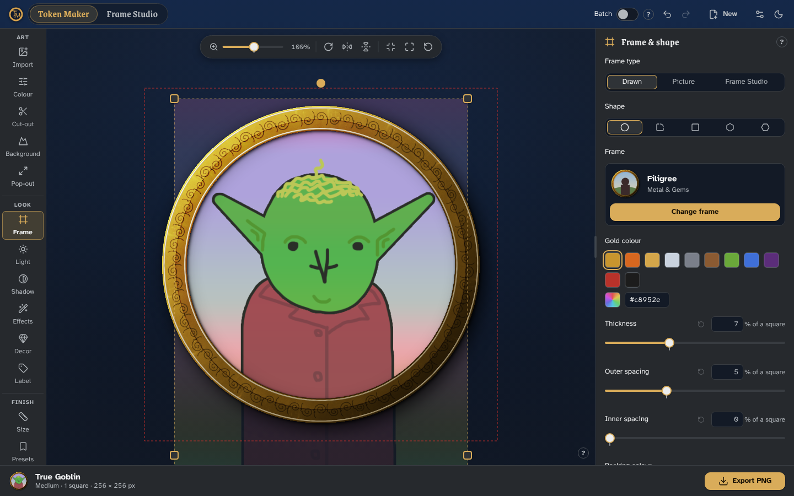
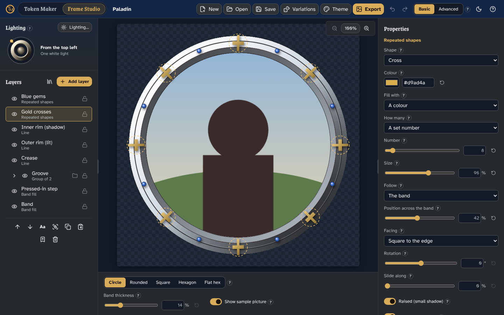

# Token Studio

**Make tokens for D&D and other tabletop RPGs, free, in your browser.**

### 👉 Try it at [tokenmaker.uk](https://tokenmaker.uk)



Token Studio is two apps in one page:

- **Token Maker** turns any picture into a round (or square, or hexagonal) token ready for a virtual tabletop such as Owlbear Rodeo, Foundry VTT or Roll20: frames, lighting, shadows, effects, decorations, labels and AI background removal.
- **Frame Studio** designs the frames that go round them, layer by layer, and sends them straight to Token Maker.

Everything runs on your own device: no accounts, no analytics, no cookies. Your pictures never leave your browser (the only exception is a web address you paste, which a small server fetches for you). Token Studio is free and open source under the [MIT licence](LICENSE).

## Quick start: your first token

1. Open [tokenmaker.uk](https://tokenmaker.uk). Token Maker opens first.
2. **Add a picture.** Click **Upload image**, drag a picture onto the page, or paste one with Ctrl+V. No picture handy? Click **Try a sample**. You can also search for art online or paste a link under **Import**.
3. **Frame it.** Drag the picture to move it, use the handles to resize or rotate it, and zoom with the slider above the token. Then pick **Frame** on the left and click **Change frame** to browse hundreds of frames (metal, stone, wood, magic, class themes…). Change its colour and thickness underneath.
4. **Style it** (all optional). The sections down the left are worked through from top to bottom:
   - **Cut-out** removes the picture's background (a flat colour, or with the AI model, which downloads once, about 100 MB), so **Pop-out** can let the character break out of the frame.
   - **Background**, **Light**, **Shadow**, **Effects** and **Decor** add a backdrop, lighting, glows, magical effects and ornaments.
   - **Label** puts a name or number on the token.
5. **Size and export.** Under **Size**, pick the creature size (Tiny to Gargantuan). Click **Export PNG** at the bottom right, or open **Export** on the left to choose the format, the pixels per square for your VTT and the file name. Turn on **Batch** at the top to make many tokens with the same look at once.

Your work is saved in your browser as you go, so you can close the tab and pick up where you left off. Every control has a **?** next to it that explains what it does.

### Designing your own frame

Click **Frame Studio** at the top left. Start from **New** (pick a template, or a blank project), then add and edit layers: bands, rims, repeated shapes like gems and studs, textures, ornaments and text. Set the lighting with the dial at the top left, and switch to **Advanced** for every control. When you are happy, click **Export → Send to Token Maker**: Token Maker switches back with your design as the token's frame, and keeps it under **Frame → Frame type → Frame Studio**.



### Themes

The moon (or sun) button at the top right picks the theme for both apps: Dark by default, with Light, Day and several others.

## For developers

Everything below is about running and changing the code.

### Running it

You need Node 22 or newer (`winget install OpenJS.NodeJS.LTS` on Windows).

```powershell
npm install
npx playwright install chromium   # only needed for the end-to-end tests
npm run dev
```

Open the address it prints (usually <http://localhost:5173>).

| Address | What it is |
|---|---|
| `/` | Token Studio: both apps, switched by the titles in their top bars |
| `/token-maker/` | Token Maker on its own (also `/token-maker/about`, `/token-maker/privacy`, `/token-maker/kit`) |
| `/frame-studio/` | Frame Studio on its own |

### Checking it works

| Command | What it does |
|---|---|
| `npm test` | Unit tests for both apps (Vitest; one project per app, each with its own set-up). |
| `npm run e2e` | End-to-end tests (Playwright): `e2e/shell` tests Token Studio's page and sending a frame; `e2e/token-maker` and `e2e/frame-studio` are each app's own tests, on each app's page. Add `--project=shell` (or `tm-desktop`, `fs-desktop`…) to run only some. |
| `npm run typecheck` | Checks the TypeScript. |
| `npm run lint` | ESLint. |
| `npm run build` | Builds the site into `dist/`, with three pages: `index.html`, `token-maker/index.html` and `frame-studio/index.html`. |
| `npm run preview` | Serves the built `dist/` folder. |
| `npm run tm:…` / `npm run fs:…` | Each app's drawing and sheet scripts (`tm:help-images`, `tm:frame-sheet`, `fs:frame-sheet`, `fs:screenshots`…). They are described in each app's docs. |

### Deploying

Cloudflare now builds new sites as **Workers** (Pages is the older option). In the Cloudflare dashboard:

1. **Workers & Pages → Create application → Import a repository** (or **GitHub**), and pick `Token-Studio`.
2. **Project name:** `token-studio`. It must match `name` in `wrangler.jsonc`.
3. **Build command:** `npm run build`. **Deploy command:** `npx wrangler deploy` (the default). Leave the root directory empty.
4. **Save and Deploy**, then open `https://token-studio.<your-account>.workers.dev`. Check `/api/health` shows `{"ok":true}`.
5. To use your own domain (the live site uses `tokenmaker.uk`), add it under the Worker's **Settings → Domains & Routes**.

Every push to `main` deploys again; other branches get a preview link. Node 22 comes from `.node-version`.

How it is set up: `wrangler.jsonc` serves `dist/` and runs `worker/index.ts` first for `/api/*` (Token Maker's image proxy for web imports) and `/token-maker/*` (so `/token-maker/about` gets Token Maker's page). `public/_headers` lets the site show its own pages in frames (`SAMEORIGIN`) and no other site can. Workers reads `_headers` too.

A Cloudflare **Pages** project still works: build command `npm run build`, output folder `dist`. `functions/` runs the image proxy there, and `functions/token-maker/` sends Token Maker's pages to Token Maker's page.

### How it fits together

```
index.html, src/shell/        Token Studio's page: each app in its own frame, the app switch and the themes both apps use.
                              Frames keep the apps' styles and keyboard shortcuts (Ctrl+Z…) apart.
token-maker/index.html        Token Maker's page   → src/token-maker/
frame-studio/index.html       Frame Studio's page  → src/frame-studio/
server/, functions/, worker/  Token Maker's image proxy for web imports
public/                       Fonts, backgrounds, pictures, help pictures and the favicon
scripts/token-maker/, scripts/frame-studio/   Each app's scripts
e2e/shell, e2e/token-maker, e2e/frame-studio  End-to-end tests
docs/token-maker/, docs/frame-studio/         Each app's design documents
```

Sending a frame: Frame Studio (`src/frame-studio/io/tokenStudio.ts`) posts the project file's text, with its preview, to Token Studio's page. The page switches to Token Maker and passes it on as soon as Token Maker says it is ready (`src/token-maker/editor/studioBridge.ts`). Token Maker then opens it exactly like a `.framestudio.json` file. Messages are only accepted from the same site.

#### The shared code copies

Each app still has its own copy of some of the other's code, carried over unchanged:

- `src/frame-studio/engine/legacy/` is a copy of Token Maker's frame renderer (`src/token-maker/render/`).
- `src/token-maker/frameStudio/` is a copy of Frame Studio's project reader and renderer.

Each copy has a `SOURCE.json`, and a test fails if a copied file is edited. Frame Studio's old `engine:sync` and `share:export` scripts, which copied these files between the two separate repositories, are not included. To update Token Maker's copy of Frame Studio after changing Frame Studio, run `npm run fs:share-copy` (add the paths of any new files the copied ones import, such as `render/newFile.ts`); it rewrites the engine's import path and the hashes in `SOURCE.json`. The engine copy is still updated by hand.

## Documents

- Token Maker's design: [`docs/token-maker/DESIGN.md`](docs/token-maker/DESIGN.md)
- Frame Studio's design: [`docs/frame-studio/DESIGN.md`](docs/frame-studio/DESIGN.md)
- Asset credits (fonts, pictures, textures and their licences, for both apps): [`ASSETS-CREDITS.md`](ASSETS-CREDITS.md)

## Bug reports and contact

For bug reports, privacy questions or takedown requests, message [u/CrystalFrogMaps](https://www.reddit.com/user/CrystalFrogMaps/) on Reddit, or open an issue on this repository.

## Licence

The code is under the [MIT licence](LICENSE). The bundled fonts, pictures and other assets keep their own licences, listed in [`ASSETS-CREDITS.md`](ASSETS-CREDITS.md). People using the site must have the rights to the pictures they upload or link to; see the Terms of use on Token Maker's Privacy page.
